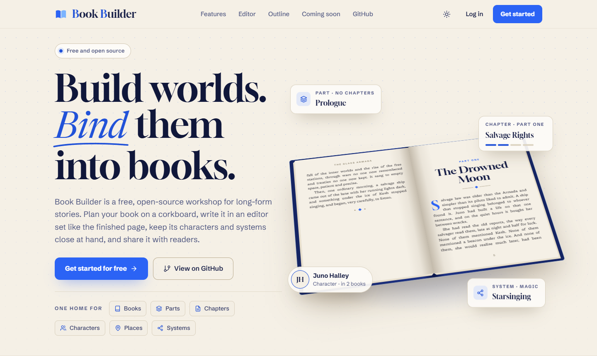
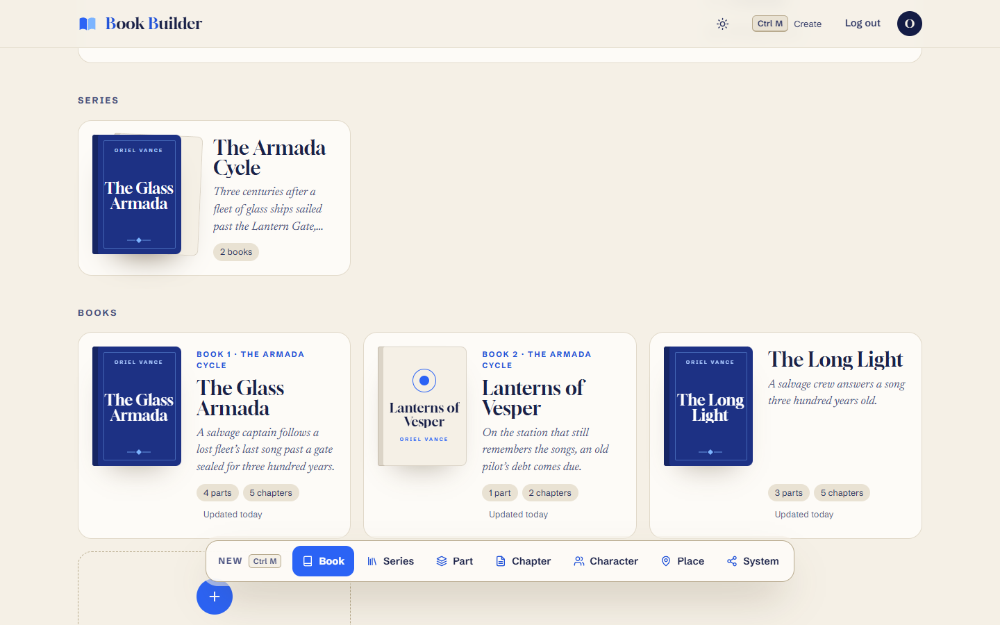
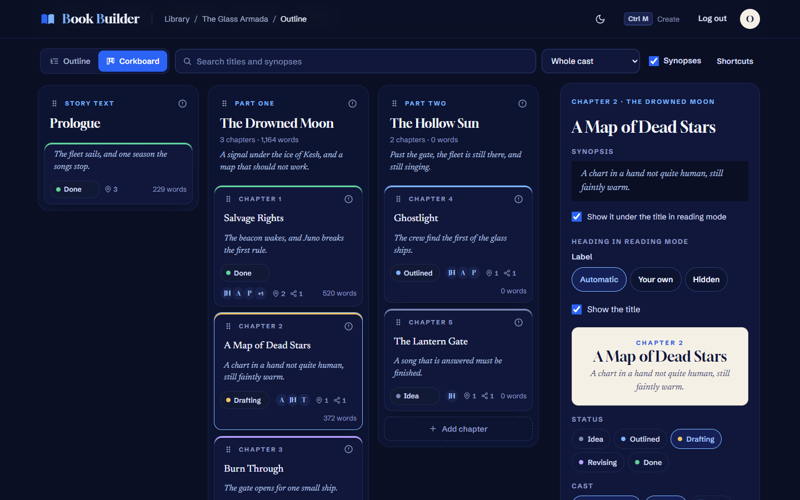
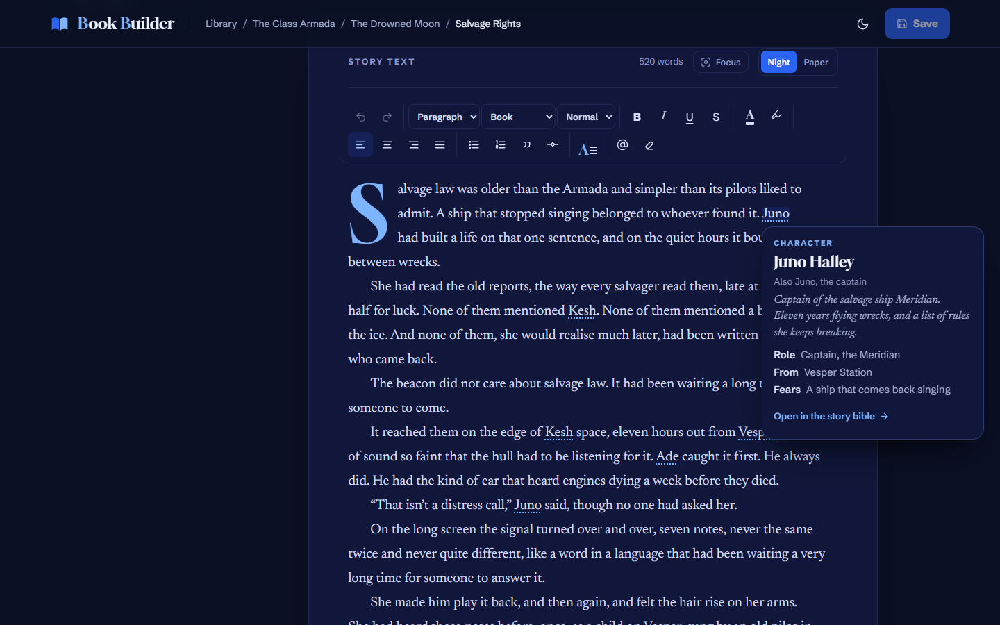
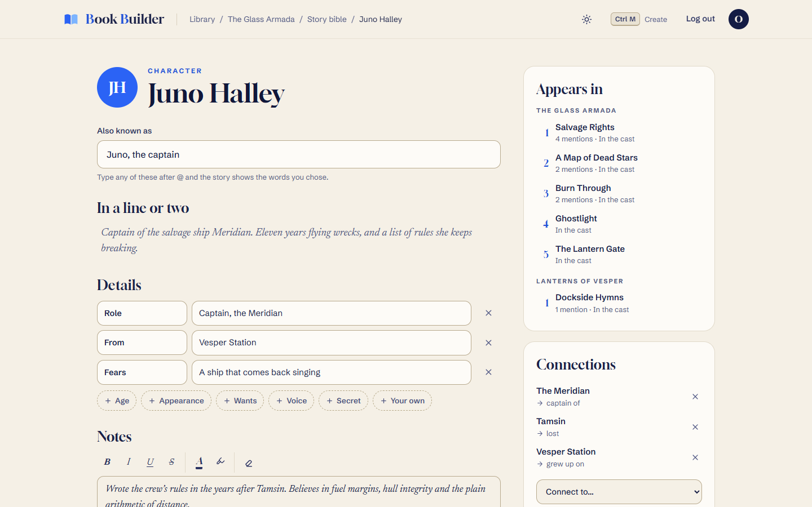
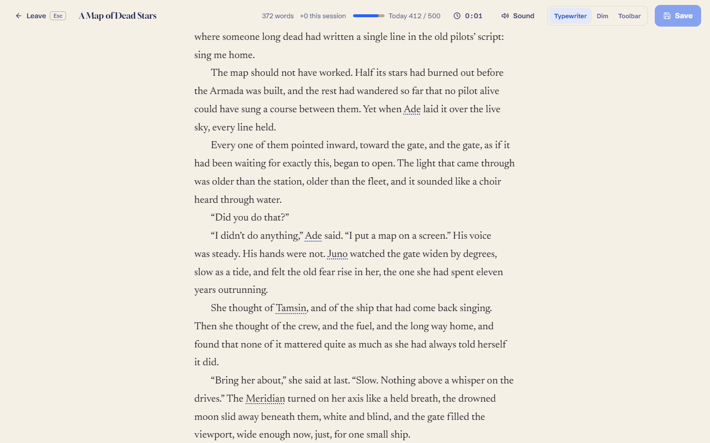
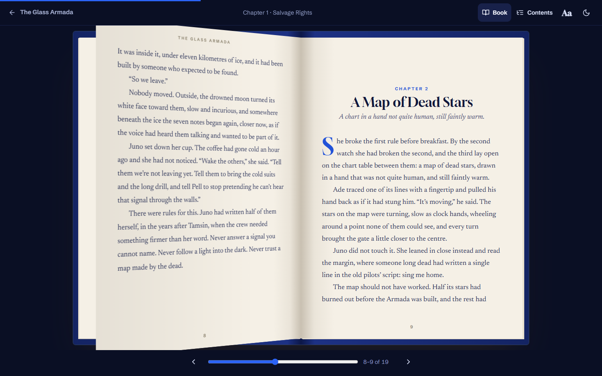

# Book Builder

**Build worlds. Bind them into books.**

Book Builder is a free, open-source workshop for long-form stories. Plan your book on a corkboard, write it in an editor set like the finished page, keep its characters, places and systems close at hand, and share it with readers.

**[Try it](https://book-builder-nine.vercel.app)** · [Meet the demo author](https://book-builder-nine.vercel.app/author/demo-author)

<picture>
  <source media="(prefers-color-scheme: dark)" srcset="docs/screenshots/hero-dark.png">
  
</picture>

## A look around

Every screenshot shows the real app, filled with _The Glass Armada_, the sample series used throughout the project.

<table>
  <tr>
    <td width="50%" valign="top">
      <br>
      <strong>Your library.</strong> Books sit on the shelf with their generated covers, and books that belong together are grouped into a series.
    </td>
    <td width="50%" valign="top">
      <br>
      <strong>The outline.</strong> See the whole book as a list or a corkboard. Drag chapters and parts around, track each one from idea to done, and choose who appears where.
    </td>
  </tr>
  <tr>
    <td width="50%" valign="top">
      <br>
      <strong>The editor.</strong> Write in the same type your readers will see, with drop caps and scene breaks. Type <code>@</code> to link a name to its story bible page, and hover for its card.
    </td>
    <td width="50%" valign="top">
      <br>
      <strong>The story bible.</strong> Characters, places and systems each get a page, and each page knows every chapter it appears in and how it connects to the rest of your world.
    </td>
  </tr>
  <tr>
    <td width="50%" valign="top">
      <br>
      <strong>Focus mode.</strong> Full screen with typewriter scrolling, a sprint timer, your word goal and ambient sound such as rain, fire or the sea. It saves as you go.
    </td>
    <td width="50%" valign="top">
      <br>
      <strong>Reading mode.</strong> Scroll through your book or read it as a real one, with 3D page turns. It remembers your place.
    </td>
  </tr>
</table>

## Also on the shelf

- **Series:** set a reading order and share one story bible across every book.
- **Manuscript insights:** chapter pacing, the words you lean on and who drifts off the page, counted from your own text with no AI involved.
- **Writing goals:** a daily word target with streaks, rest days and a history calendar, plus a word target and deadline for each book.
- **Share links:** turn one on and anyone with the link can read your book, no account needed.
- **Author pages:** a public page at `/author/<handle>` for your bio, books and series.
- **Export:** download a book or a single part as a PDF typeset at 6×9 in, or as a Word document.
- **Outline import:** paste an outline as plain text, or copy yours back out.
- **Light and dark themes**, with a Night or Paper writing surface.

## Run it locally

You'll need [Node 24](https://nodejs.org), [Yarn 1](https://classic.yarnpkg.com) and a PostgreSQL database.

```bash
git clone https://github.com/flooyd/book-builder.git
cd book-builder
yarn install
cp .env.example .env
```

Fill in `.env`:

| Variable             | What it is                                                            |
| -------------------- | --------------------------------------------------------------------- |
| `DATABASE_URL`       | Your Postgres connection string                                       |
| `ORIGIN`             | The app's address, `http://localhost:5173` for local work             |
| `BETTER_AUTH_SECRET` | A long random string, such as the output of `openssl rand -base64 32` |

Then build the schema and start the dev server:

```bash
yarn db:push
yarn dev
```

Open <http://localhost:5173> and sign up. Accounts live in your own database.

## Commands

| Command          | What it does                                                    |
| ---------------- | --------------------------------------------------------------- |
| `yarn dev`       | Starts the dev server                                           |
| `yarn build`     | Builds for production                                           |
| `yarn run check` | Checks types with svelte-check (`yarn check` is something else) |
| `yarn lint`      | Runs Prettier and ESLint                                        |
| `yarn format`    | Formats everything with Prettier                                |
| `yarn db:push`   | Pushes the schema to `DATABASE_URL`                             |
| `yarn db:studio` | Opens Drizzle Studio                                            |

`yarn db:push` is for a new or local database. Changes to a live database go through the hand-written SQL migrations in `drizzle/manual/`.

## How it's built

| Piece     | What's used                                                                    |
| --------- | ------------------------------------------------------------------------------ |
| Framework | [SvelteKit 2](https://svelte.dev/docs/kit) and Svelte 5 runes                  |
| Database  | PostgreSQL with [Drizzle ORM](https://orm.drizzle.team), on Neon in production |
| Auth      | [Better Auth](https://www.better-auth.com)                                     |
| Editor    | [Tiptap 3](https://tiptap.dev)                                                 |
| Export    | PDFKit, fontkit and hyphen for PDF, and docx for Word                          |
| Hosting   | Vercel, deployed from `main`                                                   |

```
src/
  routes/             thin route files, plus the JSON endpoints in api/
  lib/
    components/       the UI, one folder per area (book, outline, reader, rich, story...)
    server/           the database, auth, ownership checks and export
    styles/           design tokens, global styles and story text styles
drizzle/manual/       hand-written SQL migrations
.claude/skills/       detailed notes on each feature, the design system and the data model
```

## On the shelf next

- **Your account:** reset a forgotten password by email, and delete your account whenever you choose.
- **Word maps:** see the words your whole book is made of at a glance, and a map for each character, drawn from what they say.
